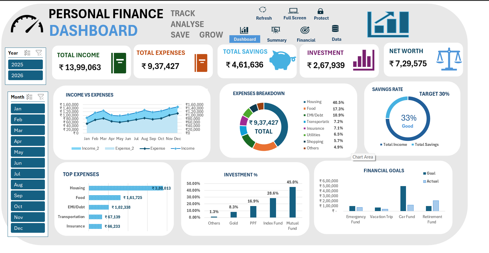
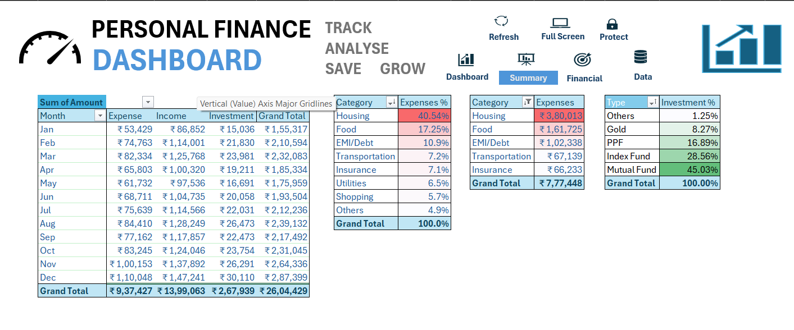

# 📊 Personal Finance Tracker

A comprehensive **personal finance management system** built in Excel.  
This tracker helps monitor **income, expenses, investments, and debt repayments** month by month, with clear categorization and insights.

---

## 🚀 Features
- Track **monthly income** and categorize expenses (Housing, Food, Transportation, Utilities, Shopping, Insurance, Others).
- Monitor **investments** (Mutual Funds, Index Funds, PPF, Gold).
- Record **EMI/Debt payments** and insurance premiums.
- Visualize spending patterns with charts and dashboards.
- Export summaries for budgeting and reporting.

---


## 📁 Project Structure

```
personal-finance-tracker/
|
|-- data/
|   `-- Personal Finance.xlsx        # Your uploaded Excel file
|
|-- screenshots/
|   |-- dashboard-overview.png       # Screenshot of Excel dashboard
|   |-- expense-breakdown.png        # Pie chart of expenses
|   `-- investment-growth.png        # Line chart of investments

|-- README.md                        # Main documentation with screenshots
```

---

## 🖼️ Screenshots

### Dashboard Overview


### Expense Breakdown


### Investment Growth


👉 Place your screenshots inside the `screenshots/` folder and update the paths above.

---

## 📈 Example Insights
- **Income Growth:** Salary increased from ₹29,801 (Jun 2025) to ₹89,719 (Mar 2026).
- **Expense Trends:** Housing rent rose from ₹7,760 (Jun 2025) to ₹20,334 (Mar 2026).
- **Investments:** Regular SIPs in mutual funds, index funds, PPF, and gold show consistent portfolio growth.
- **Debt Management:** Personal loan EMI payments tracked monthly, peaking at ₹6,173 (Mar 2026).

---